# Nomad's Seekers: Prototype

Godot 4.7, 3D, Forward+. Open `project.godot` in the editor and press **F5**.

Built in playable parts (see the Prototype Roadmap in the Claude project). Current: **Part 13a, levels made from data (the level editor's runtime)**, now on **level format 2** (pieces, navmesh rooms).

F5 starts at the title screen (`scenes/title.tscn`). From there you reach Nomad-2 (`scenes/hub.tscn`), whose teleporter goes to the gym test room (`scenes/main.tscn`) and the test arena (`scenes/arena.tscn`, two wave rooms of real enemies). Any level can still be opened and run on its own with F6; it plays your last character.

## Part 1: movement
- **Seeker controller** (`scripts/player/player.gd`): camera-relative movement with snappy acceleration, a variable-height jump with coyote time and an input buffer, and a dash/dodge with i-frames, one air dash, and dash-jump (jump during a ground dash to keep momentum).
- **PSO-style camera** (`scripts/camera/camera_rig.gd`): a loose follow camera by default. It trails you like someone walking behind you with a camera: it doesn't turn when you turn, only swings around as you walk away from it, and backs up when you walk toward it. After you look up or down, it eases back to its default height. Set `follow_mode` to RIGID for a third-person shooter style camera. It avoids walls and supports right-stick and mouse look.
- **Lock-on** (R3): targets whatever is closest to where the camera faces, the Seeker strafes and orbits the target, flick the right stick to switch targets, and lock breaks when the target goes out of range. With nothing in range, R3 recenters the camera to where you were facing at the moment you pressed it.
- **Input map** (`scripts/autoload/input_setup.gd`): the full North Star control map, registered in code.

## Part 2: combat
- **Hand buttons** (`scripts/combat/combat_controller.gd`): X is your **primary hand** and Y your **off hand** (Part 8: menus list the primary hand first; a character's handedness, picked at creation, only decides which side the primary weapon is drawn on). Tap for a Normal attack, hold for a Hard attack.
- **Timing combos**: 3 steps per chain, using PSO's windows. The chain window opens when the swing ends (PSO's "combo" frame, just after the hit) and closes when the recovery ends; chaining cancels the rest of the recovery. Timing is judged when the button goes down, so a Hard hold that starts in the window still chains. `early_tolerance` (0.15 s) is an input buffer: a press slightly before the window counts and fires the moment the window opens, never cutting the swing short. Earlier than that breaks the combo; too late starts a new chain. Any attack from either hand can fill the next step.
- **Weapon steps**: each weapon counts its own consecutive uses. Sword, Sword, Sword plays Slash, Return Slash, Cleave with bonus damage. Sword, Pistol, Sword plays the sword's Slash both times.
- **PSO timing**: the starter weapons use PSO Blue Burst's frame data for hit frames, attack length and window length (30 fps) from the [Ephinea wiki](https://wiki.pioneer2.net/w/Game_mechanics/Frame_data): saber timings for the Sword, handgun for the Pistol, and Foie's cast time for spells. `tools/build_starter_weapons.gd` lists the source frame numbers next to each attack.
- **Starter weapons** (`data/weapons/*.tres`): Sword (melee), Pistol (projectiles, costs a little LP), Wand (casting item: Fire Bolt, or Frost Lance with RT held), and Dervish Blades (two-handed, sustained). Spells are standalone and end a chain. Sustained weapons (Dervish Blades, Machine Pistol, Assault Rifle) don't combo either: hold to sustain, and each tap is a single standalone attack. Edit the `.tres` files in the Inspector.
- **Moving while attacking** (PSU-style): each attack's `move_speed_scale` is 0 (rooted) or the fraction of run speed you keep. Melee roots you, except Dervish Blades. Normal shots and Normal spells let you walk at half speed; Charged shots and Hard spells plant your feet. With nothing targeted, a mobile shot fires where the stick points.
- **Dervish Blades**: the machinegun of melee. Tap for quick spinning slashes you can walk through (both buttons count as the same weapon for combo steps). Hold to spin continuously, hitting everything around you every 0.2 s while moving at 60% speed; release to stop.
- **LP**: spells and shots cost LP. Like PSO's TP, it doesn't regenerate on its own (it did until 2026-11-09, as a testing convenience), except for **Goluman and Lumera**, who regenerate **1% of max LP a second** (it pauses for 0.75 s after you spend LP). Debug tab: Infinite LP.
- **Damage types and stats**: damage = base x step multiplier x (1 + STR/DEX/SOL / 100), with crits from LCK. Every attack carries one element.
- **Dash cancel**: dashing cancels an attack once its hit is out.
- **Dummies with HP** (`scripts/enemies/target_dummy.gd`): floating damage numbers colored by element, hit flash, and respawn after death. DummyC is weak to Fire and resists Ice; DummyD is weak to Ice.
- **Navmesh movement**: the test room's `Navigation` region bakes a navmesh at startup from the level's collision. Dummies move with `NavigationAgent3D`: DummyB patrols, and DummyE chases you around obstacles. The same navmesh will later generate the area map.

## Part 3: loadouts and blocking
- **Loadout menu** (Start / Tab, `scripts/ui/loadout_menu.gd`): 8 loadouts. Pick a hand, then a weapon. The game pauses while it's open, and closing saves to `user://loadouts.tres`. LB/RB cycles loadouts, skipping empty ones and ones that break a rule.
- **Rules** (`scripts/combat/loadout.gd`): a two-handed weapon uses both hands (equipping one clears the other hand). Only one Heavy item per loadout; the **Double-Heavy augment** (a menu toggle until armor exists) allows two Heavy one-handed items, including a Heavy Shield with an Axe.
- **LT depends on the loadout**:
  - Shield in either hand: full block at the shield's strength (Shield 60%, Heavy Shield 85%). A hit in the first 0.2 s of the block is **parried** (no damage, the attacker is staggered).
  - Two-handed weapon: weak block (Great Sword 35%, Dervish Blades 30%).
  - Anything else, including a powerstanced pair: arms-up block, 25%.
  - Blocks and parries only cover the front (140°). Blocking slows you to 40% speed.
  - With a shield you can attack without dropping the block; those attacks deal 66% damage. Other blocks drop while you attack.
- **Powerstance**: a pair of the same weapon type (even different items, like Sword + Frost Sword) always attacks with both weapons, each at 75% (1.5x total), on either button. Twin attacks chain their own 3 steps. Twin casting items cast both spells at full power and full LP.
- **RT + a hand's button** uses the special of the weapon in that hand (`WeaponData.special_attack`); with a powerstanced pair, the other hand swings normally at the same time. No weapon has a special until Part 5, so for now RT + a button is a normal attack (or the second spell on a casting item).
- **Two-handed weapons are one item**, held in the primary hand and used by both buttons.
- **Target markers** (PSU-style, `scripts/ui/target_markers.gd`): rings on every enemy each hand's next attack would hit, shown for both hands at once: **blue** for the primary hand (X), **yellow** for the off hand (Y), **green** when both would hit the same enemy. You can see a Great Sword sweep catching two enemies, or a piercing Frost Lance lining up a row. The locked-on enemy also gets a larger red ring, dimmed when neither hand would reach it. Predictions include the attack's lunge and update while you hold RT (specials and second spells).
- **Sword hitbox narrowed** to match PSO's single-target saber; the Great Sword is the wide sweep.
- **Shield hand button**: Shield **Deflect** opens a parry window; Heavy Shield **Shove** knocks enemies back.
- **Dodge**: hits during the dash's i-frames are dodged.
- **New weapons**: Shield, Heavy Shield, Great Sword (PSO sword frames), Axe (PSO partisan frames), Frost Sword (now just a Sword with the Ice line's "Frost" tag, so it powerstances with the Sword and is never a drop base).
- **Block practice** in the test room: the Swinger glows orange, then swings; the Shooter fires slow pink bolts. Parry the Swinger to stagger it (it glows blue).
- **Taking damage**: the Seeker now has HP that enemies can reduce, and respawns at the start on death.

## Part 4: enemies and rooms
- **Arena** (`scenes/arena.tscn`, built by `tools/build_arena.gd`): a start corridor and two PSO-style **wave rooms**. Walking in closes the doors (glowing orange), each wave spawns when the last enemy of the previous one falls, and the doors open after the final wave. Room A has three waves, Room B two (the last one has all six enemy types).
- **Wave rooms** (`scripts/rooms/wave_room.gd`): add `WaveData` resources (a list of enemies) to `waves`, put CSG doors under `Doors` (outside the Navigation region, so the navmesh is baked with the doorways open) and `Marker3D` spawn points under `SpawnPoints`.
- **Enemies** (`scripts/enemies/enemy.gd`, data in `data/enemies/*.tres`): navmesh AI. They idle until you come within aggro range or hit them, then path to you. Melee enemies close in; ranged and spell enemies hold their distance and back off if you get too close. Every attack is telegraphed: the enemy glows in its element's color, then strikes. Hard hits and big hits stagger them, a parry staggers them longer, and a shove knocks them back.
- **One enemy per monster type** (North Star §2.6):

| Enemy | Type | Fights by | Element |
|---|---|---|---|
| Grub Hound | BEAST | Charges and swipes | — |
| Mutated Crawler | MUTATED | Fast, evasive bite | Nature (Poison) |
| Sentry Drone | SYNTHETIC | Hovers, keeps ~9 m, shoots | Lightning (Shock) |
| Umbral Eye | DARK | Floats back, slow casts | Dark (Drain) |
| Caustic Ooze | ALCHEMIC | Slow, tanky, slams all around it | Fire (Burn) |
| Lumen Sprite | LIGHT | Evasive, darting caster | Light (Confuse) |

- **Status effects** (`scripts/combat/status_effects.gd`, rules set 2026-11-12) on enemies, dummies and the Seeker: elemental hits build up; past the threshold the status starts. Your statuses show above the HUD bars; enemies list theirs under their HP. **Cure** (spell, Cure Salt, Mending Bloom) clears any of them.

  | Status | From | Effect | Lasts |
  |---|---|---|---|
  | Burn | Fire | Damage over time | 5 s; **wiggle the stick** to burn it off faster |
  | Slow | Slow traps only | Half speed | 7 s |
  | Freeze | Ice | Can't move or act | 5 s; **mash buttons and wiggle the stick** to break out sooner |
  | Shock | Lightning | Seekers move but can't attack | **Until cured.** Goluman and enemies are stopped in place for 5 s instead (mashing shortens it) |
  | Poison | Nature | Damage over time | **Until cured**, or until it brings you to 1 HP (it never kills) |
  | Confuse | Light | Enemies attack whoever is closest, friend or foe. Seekers hit and heal friend and foe, can lock onto partners, lose their target rings, and see every enemy and partner as the same ghost behind a haze | 4 s |
  | Drain | Dark | Damage over time that heals whoever applied it | 4 s |
  | Stun | Jarring tag, traps and hazards | Can't move or act; on Seekers any hit ends it | 5 s |

  Each button press or stick swing takes 0.25 s off. Burn and Poison damage on Seekers scales with difficulty (Normal ×1, Hard ×1.5, Very Hard ×2, Ultimate ×3).
- **Defense stats**: DEF reduces melee damage, RES reduces magic, EVA reduces ranged and gives a chance for melee and ranged attacks to miss (spells always land). Reduction is 100 / (100 + stat). Enemies have their own DEF / RES / EVA, weaknesses and resistances.
- **Ward and Barrier** (magic shields): block 50% / 75%. Their hand button (Reflect) and a fresh LT press open a reflect window: an enemy shot or spell that hits you then flies back at the shooter, faster. They can't parry melee, only block it. Add them to a loadout in the menu.
- **All hits go through `HitResolver`**, so blocks, parries, reflects, misses, defense and status work the same for every weapon and enemy.

## Part 5: weapons and loot
- **The full weapon list** (North Star §5.3) plus the Gunblade and Burstbow, 41 weapons in `data/weapons/`. Timings come from PSO frame data (Ephinea, 30 fps) where PSO has the weapon or a close relative; the rest scale the nearest table (noted in `tools/build_starter_weapons.gd`).
  - **Melee:** Sword, Great Sword, Bladestaff, Dagger, Spear, Halberd, Mace, Maul, Flail, Axe, Great Axe, Glove, Dervish Blades.
  - **Ranged:** Pistol, Machine Pistol (automatic pistol: tap = single shot, hold = automatic; a powerstanced pair fires both), Hand Shotgun and Shotgun (pellet spreads), Rifle (piercing, long chain window), Assault Rifle (hold = automatic), Bazooka (rocket, big blast), Grenade (thrown in an arc; 3 in a row ends with a double throw), Grenade Launcher (lobbed, status-heavy), Thrown Daggers, Boomerang (homes in on up to 5 enemies in turn), Gigarang (hits on the way out and back), Bow, Crossbow, Arbalest, Burstbow.
  - **Magic:** Wand, Cane (stronger, slower damage spells), Staff (two-handed, four spells: X, Y, RT + X, RT + Y), Talisman and Totem (Heal and Cure), Cards (SOL damage, thrown at several enemies).
  - **Hybrid:** Gunblade (Heavy, two-handed, Striker / Ranger): a blade between the Sword and Great Sword when you're not locked on, a gun between the Pistol and Rifle when you are. The HUD shows which mode it's in.
  - **Burstbow** (Ranger): PSO's shotgun. Rifle-slow shots that pick 3, 3, then 5 enemies.
  - **Targeted volleys:** Thrown Daggers (1 / 3 / 5 enemies), Cards (1 / 2 / 4) and the Burstbow throw one projectile at each picked enemy, so no enemy is hit twice by one attack, and each projectile flies past everything but its target. Shotguns keep their even spread.
  - **Piercing:** only the Arbalest and Gigarang pass through enemies (the Boomerang homes from one to the next). Specific rares, like Stormcaller, can pierce too.
  - **Shields:** Shield, Heavy Shield, Ward, Barrier.
- **Jobs.** Each weapon lists the jobs that can use it (S Striker, R Ranger, I Invoker). Loadouts holding a weapon your job can't use say "job locked" and LB/RB skips them. The job is chosen at character creation and can't change afterwards (unlike PSU); the Debug tab has a switch for testing.
- **Special tags** (reworked 2026-11-12, our own names). Found weapons can roll a tag line in tiers; the tag names the weapon ("Flame Sword") and unlocks its **RT special**: hold RT and press that hand.

  | Kind | Lines (weak → strong) | Weapon deals | RT special |
  |---|---|---|---|
  | Status | Smolder · Scorch · Sear · Immolate (Fire) / Chill · Frost · Rime · Glacial (Ice) / Static · Jolt · Shock · Overload (Lightning) / Toxic · Venom · Blight · Plague (Nature) / Dazzle · Daze · Bewilder · Delirium (Light) / Gloom · Wither · Decay · Entropy (Dark) | Its element | Half damage, builds the element's status hard (Burn, Freeze, Shock, Poison, Confuse, Drain); LP 4 + 2/tier |
  | Stun | Jarring · Staggering · Concussive · Pulverizing | Its own type | Half damage, builds Stun hard; LP 4 + 2/tier |
  | Burst | Heat · Fire · Flame · Inferno / Shard · Hail · Shatter · Avalanche / Spark · Bolt · Thunder · Skyfall / Thorn · Bramble · Briar · Overgrowth / Glint · Gleam · Radiant · Sunburst / Shade · Dusk · Void · Abyss | Its element | x1.3, then bursts (3 m) onto the 2 nearest enemies for the same damage; LP 8 + 4/tier |
  | Instant kill | Grim · Doom · Reaper · Oblivion | Its own type | 5–20% instant kill (never bosses) |
  | HP steal | Leech · Siphon · Vampire · Sanguine | Its own type | Heals 10–25% of the damage |
  | LP steal | Lucid · Focus · Insight · Epiphany | Its own type | Restores LP: 10–25% of the damage |
  | EXP steal | Mentor's · Sage's · Oracle's | Its own type | +5–15% of the target's EXP |
  | HP cut | Rending · Sundering | Its own type | Cuts 25% / 40% of the target's HP, costs you 10% |
  | Charge | Tithe · Zeal · Frenzy | Its own type | x3 hit for 100 Oro / 30 LP / 15% HP |

  The other element-less specials hit x1.3. **Ice never Slows** (weapons or spells): it builds Freeze directly. Only Slow traps Slow.
- **Monster-type bonuses** (PSO's "% vs Native"): +5–30% damage vs one of the six monster types.
- **Drops.** Enemies give EXP and roll a drop where they fall: Oro, a consumable, or a weapon. Weapons come from your **emblem's pool**: each of the 12 emblems (Crimson, Orange, Gold, Green, Teal, Cyan, Blue, Purple, Magenta, Pink, White, Black; from name + race + gender + job, like PSO section IDs) favors two weapon families and carries its own **rares** (Emberfang, Glacier Maw, Stormcaller, Gravesong, Lifeleech Coil, Lumen Edge, Kingmaker). Oro (and Lumidium) is picked up by walking over it and drifts to you when you're close; everything else waits for **A** (there will be an inventory limit).
- **Heal and Cure** (Talisman, Totem, Staff): Heal restores HP, Cure clears every status. Both reach other Seekers within 10 m.
- **Consumables:** HP Gel, LP Cell, Cure Salt, Trap Scanner. D-pad left / up / right / down or 1 / 2 / 3 / 4.
- **Lumidium.** Crystal deposits in the arena break after 3 hits into Lumidium of their color. Carried Lumidium is lost when you die; stand on a **teleporter** pad to bank it.
- **Menu tabs** (LB/RB in the menu): Loadouts (the picker now lists found weapons first, greyed out if your job can't use them), Inventory, Character.
- **Save file:** `user://save.tres` holds the character, loadouts and inventory. It's written when the menu closes and at teleporters. Part 3's `loadouts.tres` is imported once.

## SyncAIDa (merged into Part 5)
- **Your SyncAIDa** floats just over and behind your right shoulder (the camera is centred on the Seeker, so future twin SyncAIDa can take both shoulders). Its color follows its strongest stat and its shape changes with each evolution.
- **Starter choice:** a new Seeker picks one of four starters in the menu's **SyncAIDa** tab (the menu opens there until you've chosen). Each starts at **level 5 in one stat**, so it boosts what your character needs right away: Aegi (DEF), Kindle (STR), Swift (DEX), Lumi (SOL). You can own several and pair one; with Free feeding on, the tab also lets you adopt more starters for testing.
- **Feeding** (SyncAIDa tab): consumables come from your inventory and Lumidium from your bank. Each item raises some of **DEF / STR / DEX / SOL** and may lower another, as in PSO, but a lowered stat only loses progress toward its next level: a stat level, once earned, is never lost. Every 100 XP in a stat is one stat level. The SyncAIDa's level is the sum of its stat levels, up to **200**. Each stat level adds to your matching stat: STR and DEF +2, DEX and SOL +1. The SyncAIDa tab shows each stat's level and a bar with its progress to the next level, as in PSO.
- **Evolution** (PSO-style formulas):
  - **Level 10:** takes a form from its strongest stat (Shell, Ember, Flit or Glimmer).
  - **Level 35:** takes a form from its strongest stat (Bastion, Talon, Kestrel or Wisp).
  - **Level 50 and up:** takes a form from its two strongest stats (Bulwark, Sentinel, Oracle, Falcon, Pyre or Zephyr), re-checked every 5 levels.
  - **Level 100:** adds "Prime".
  - Forms depend only on the SyncAIDa's stats, never your job, so one character can raise a SyncAIDa for another (PSO's mag meta-progression).
- **Sync Burst** (L3 / R when the gauge is full). The gauge fills from damage you deal and take. Each milestone (10 / 35 / 50) unlocks a burst, up to 3. Choose the active one in the SyncAIDa tab.
  - **Lumen Nova:** Light damage to every enemy within 8 m. Scales with level and SOL.
  - **Aegis Pulse:** for 15 s, nearby Seekers deal +30% damage and take -30%.
  - **Mending Bloom:** heals nearby Seekers 50% HP, restores 30 LP and clears statuses.
  - Firing a burst gives a moment of invulnerability.
- **Free feeding (debug)** in the SyncAIDa tab feeds without using items, so you can try evolutions quickly.

## Part 6: magic, traps and hit chance
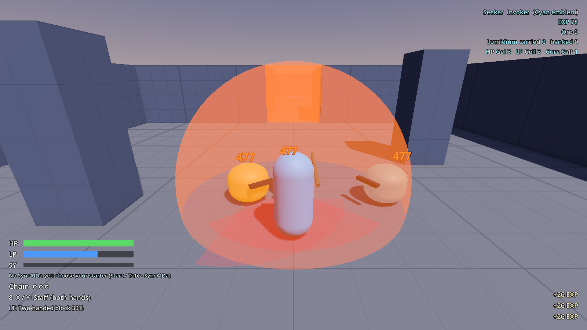

- **Hit chance (ATA vs EVA).** Seekers and enemies now have **ATA** (accuracy) and **EVA** (evasion). Every weapon hit rolls, PSO-style but kinder:
  - Hit % = 60 + effective ATA − EVA × 0.2 + streak, clamped to 5–100%.
  - Effective ATA = ATA × attack type × combo step. Combo steps 1 / 2 / 3 give ×1.0 / ×1.3 / ×1.69, so finishers almost always land.
  - Attack type: Normal ×1.0, Hard ×0.9, but **opening** a combo with a Hard is ×0.7. Specials ×0.8.
  - **Streak (Chrono Cross):** every hit that lands adds +4% to the next one in the combo, up to +12%.
  - Frozen targets have 30% less EVA, Shocked or Stunned 15% less.
  - **Spells, traps and hazards never miss.** Misses show "Miss".
  - Enemy EVA / ATA: Ooze 30 / 40, Drone 50 / 60, Hound 60 / 50, Umbral 70 / 55, Crawler 90 / 55, Sprite 140 / 60. EVA no longer lowers ranged damage; DEF covers both.
- **Hit reactions.** Light and sustained hits only interrupt an enemy if one hit takes half its max HP. Hard hits **push back and flinch** 90% of the time (bosses 25%), like PSO.
- **Magic** follows Grayson's spell grid: 6 elements × 7 spell types, plus Heal, Cure, Teleportal and Revive.
  - Spells live in the **casting item's slots**, set in the menu's **Spells** tab. One-handed items have 2 slots (tap / hold RT + tap), two-handed items 4 (X, Y, RT + X, RT + Y). Hold the button for a **Hard cast**: ×1.6 power and LP, a bit slower, rooted, 25% bigger area.
  - Damage uses PSO's formula: (SOL + technique power) / 5 × the item's spell power. Fire, Ice and Lightning use the real Foie / Barta / Zonde tables; Nature, Light and Dark are my best guesses in the same shape.
  - **Shapes:** single target (Fajro, Glacio's piercing line, Fulmo, Arbo's ground thorns, Lumo, Malbo), small bursts (ring, spear fan, chain, 30° and 60° cones, rolling gravity ball), large areas (Granfajro and friends; Granmalbo pulls enemies to the center), sustained channels (hold to keep casting), buffs (+STR / DEF / DEX / SOL / ATA / EVA), debuffs on enemies around you, and auras that pulse damage near you.
  - Single-target spells and Fire / Ice / Lightning / Nature / Light auras don't inflict status; everything else can. Pasmalbo can.
  - **Cure** clears one more status per level in order of annoyance (Slow, Burn, Poison, Confuse, Drain, Shock, Stun, Freeze); level 9 also clears debuffs. **Teleportal** opens PSO's telepipe: a pad to Nomad-2 and one back (see Travel). **Revive** waits for co-op.
- **Learning.** Each spell needs SOL to learn: its base, +20 a level for the first half, +40 after (Cure +25, Revive +30 / +60). Max spell level: **15**, Lumera 20, Coresian 10. **Invokers reach 30 in everything**, whatever their race. Strikers reach 5 levels less in buff spells, Rangers 5 less in debuff spells (a Human Ranger tops out at 10 in debuffs). Cure, Revive and Teleportal always reach their own max. New Seekers know Fajro, Glacio and Fulmo.

  | Max level | Striker (buffs) | Ranger (debuffs) | Invoker |
  |---|---|---|---|
  | Human | 15 (10) | 15 (10) | 30 |
  | Lumera | 20 (15) | 20 (15) | 30 |
  | Coresian | 10 (5) | 10 (5) | 30 |
  | Goluman (traps) | 15 | 15 | can't be Invokers |
- **Spell discs** drop from enemies (about 6% of kills). A disc you can read is learned; one you can't yet is stored (read it from the Spells tab later); one you already know is sold for Oro.
- **Race stat bonuses:** Humans +5 STR / DEX / SOL, Coresian +10 STR, Lumera +10 SOL, Goluman +10 DEX.
- **Goluman** can't cast and can't be Invokers. In return they **slowly regenerate HP** (0.5% of max HP a second) **and LP** (1% of max LP a second, which Lumera share). Like PSO's androids they're **immune to Poison and Stun**, but **weak to Shock**, which stops them in place where other Seekers can still move. They set **traps** instead (Damage, Slow, Shock, Poison, Confuse, Freeze, Stun) from the same slots, learned with DEX. Up to 4 at once; they arm after 0.6 s and spring on the first enemy. Trap discs only drop for Goluman.
- **Level hazards.** Six hidden traps sit in the arena; each springs once. Each has a small device that can be locked on to and destroyed with any attack, but **only while the trap is visible**: after a **Trap Scanner** (D-pad down) reveals the room you're in, or always for Goluman. Hidden traps can't be hit by anything, area spells included.
- **Stun** (named Paralyze until 2026-11-09): 5 s, no moving or acting. On a Seeker it ends early when they're cured or a hit lands (damage over time and hazard drains don't count), so it's gentler than Freeze. Enemies stay stunned while you hit them.
- **Materials (PSO).** Each use permanently raises one stat by 2: Power (STR), Dex (DEX, new), Mind (SOL), Def (DEF), Res (RES, new), Evade (EVA), Accuracy (ATA, new), Luck (LCK), HP and LP (PSO's TP Material). Use them from the **Inventory** tab (Part 9; the Character tab is now Status).
  - PSO's limits: the eight stat materials share one limit: **Humans 275, Lumera and Coresian 175** (PSO's 250 / 150, +25 for the new materials), **Goluman 150**. HP and LP have their own 125 each.
  - Goluman can't use Mind Materials (no magic), and can use only 75 LP Materials.
  - They drop from enemies (about 2.4% of kills). Debug tab: +10 of each. Reset character forgets the ones used.
  - Accuracy has no other source yet; character levels and gear will add to it.

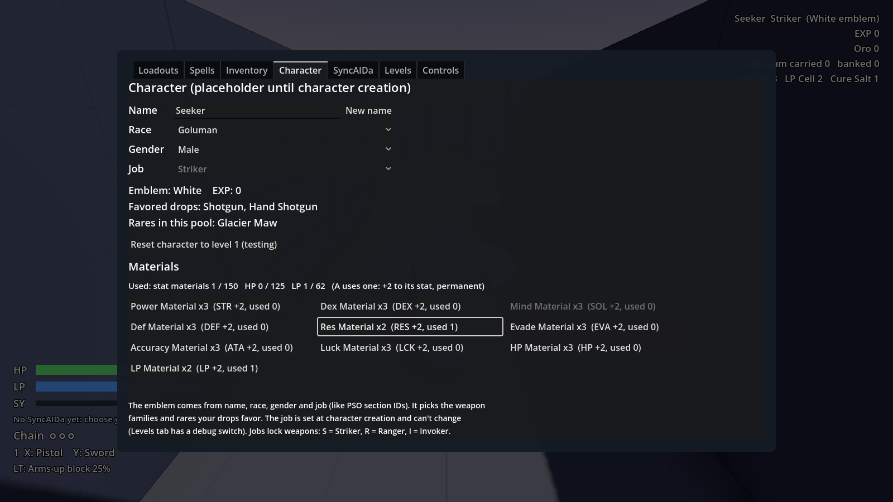

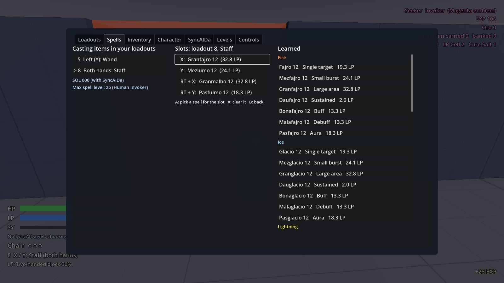
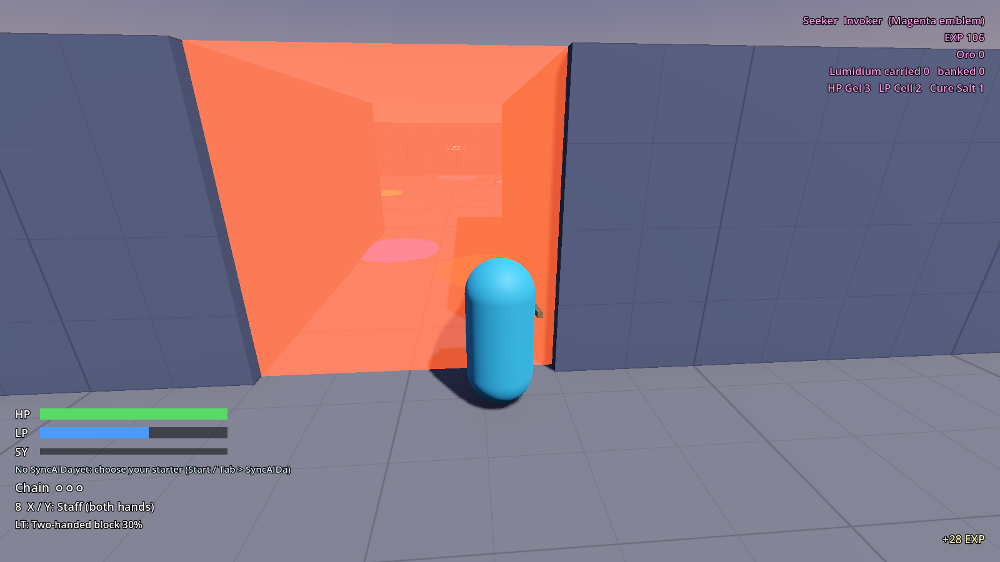
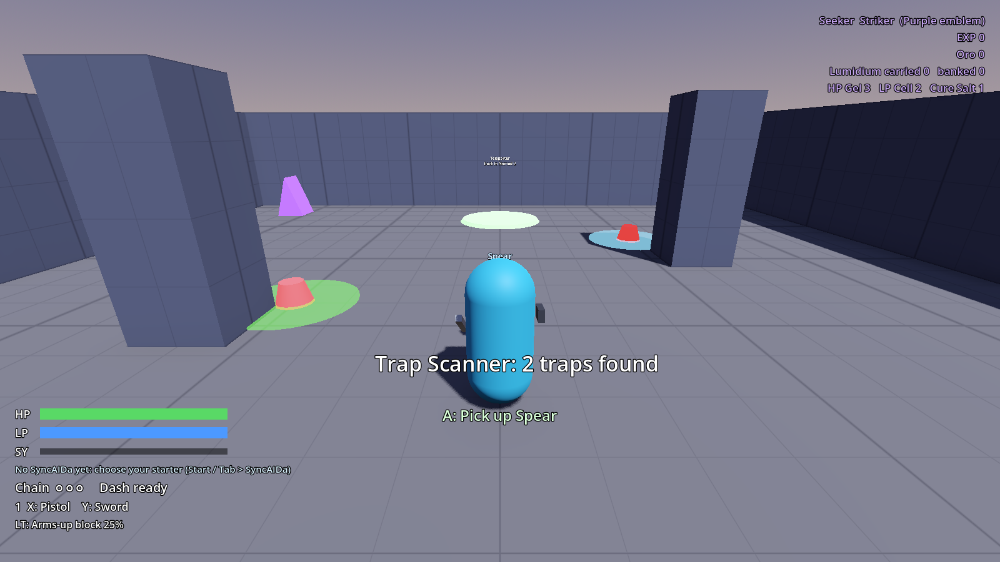

## Part 7: armor
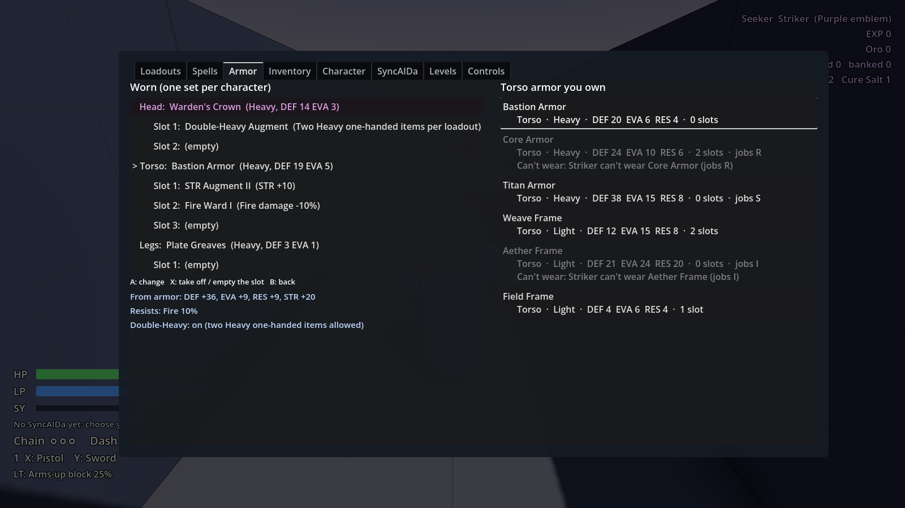

- **One set per character** (like PSO and PSU): **Head**, **Torso** and **Legs**. Head and Legs take the place of PSO's barrier.
- **Light and Heavy** pieces. **Invokers wear Light only**; Strikers and Rangers wear either.
  - Light: Field, Weave, Lumen and Aether sets (Frame / Hood / Treads).
  - Heavy: Plate, Bastion, Core and Titan sets (Armor / Helm / Greaves).
  - Heavy pieces give more DEF; Light pieces give more EVA and RES. Head and Legs are about 40% of a Torso.
  - **Job-locked sets:** Core is Ranger-only, Titan Striker-only, Aether Invoker-only.
- **Drops roll like PSO frames:** a DEF / EVA bonus within the piece's range, and **augment slots**: a Torso has 0-4, a Head or Legs piece 0-1.
- **Augments** (PSO's units) are items that go in and out of slots freely:
  - Stat augments I / II / III: STR, DEX, SOL, DEF, RES, EVA, ATA, LCK (+5 / 10 / 15), HP (+20 / 40 / 60), LP (+10 / 20 / 30).
  - Element Wards I / II: 10% / 20% less damage of that element.
  - Monster Guards: 15% less damage from one enemy type (Beast, Mutated, Synthetic, Dark, Alchemic, Light).
  - **Double-Heavy augment** (rare): any slot, and two Heavy one-handed items are allowed. It replaces Part 3's menu toggle.
  - Resistances stack up to 75%.
- **Rares** break the usual rules: Ironclad Shell (Goluman only), Veil of the Nomad (Invoker, +10 SOL, Light / Dark resist), Huntress Treads (female only, +8 DEX), Warden's Crown (Striker, +10 STR, **2 slots**), Pathfinder Treads (+5 ATA, **2 slots**).
- **Drops:** armor from about 5% of kills (the **Blue emblem** finds it twice as often), augments about 2.4%. 4% of armor drops are rare.
- Every Seeker starts in a **Field Frame** with one slot (old saves get one too). Armor you can no longer wear after a race, gender or job change comes off.
- **Dash cooldown:** 5 s between dashes (shown next to the chain pips on the HUD).

## Part 8: title screen, characters and Nomad-2
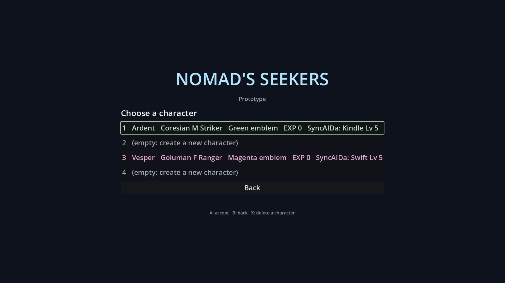

- **Title screen** (gamepad: A or Start accepts, B goes back): **Continue** (your last character), **Character select**, Quit.
- **Every menu recovers focus for the controller:** if nothing is focused (say, after clicking the window to bring it forward), the first A or d-pad press focuses the menu's default button instead of doing nothing. Character creation starts on Race, so the d-pad isn't caught in the name box.
- **4 character slots**, like PSO. Each slot is a whole save (character, loadouts, inventory, spells, armor, SyncAIDa) in `user://characters/slot_N.tres`. X on a slot asks, and a second X deletes it. Your Part 5-7 save moves into slot 1 the first time.
- **Primary and off hand:** loadouts read primary hand (X) first, then off hand (Y), everywhere. The code uses the same names (`Hand.PRIMARY` / `Hand.OFF`, `Loadout.primary` / `off_hand`), so **saves from before this change don't keep their loadouts**: make a new character. Creation asks for the **primary hand** (right or left): a left-handed Seeker holds the primary weapon on the left side, still on X. The Debug tab can change it for testing.

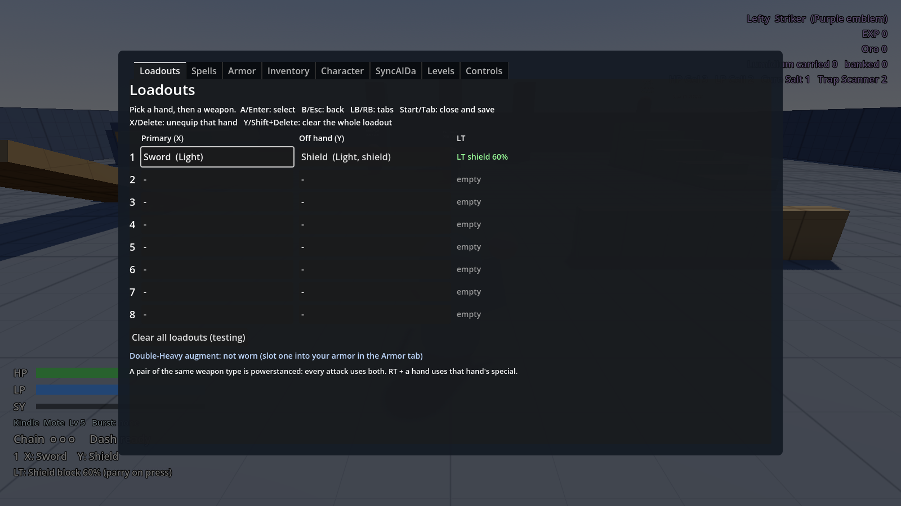
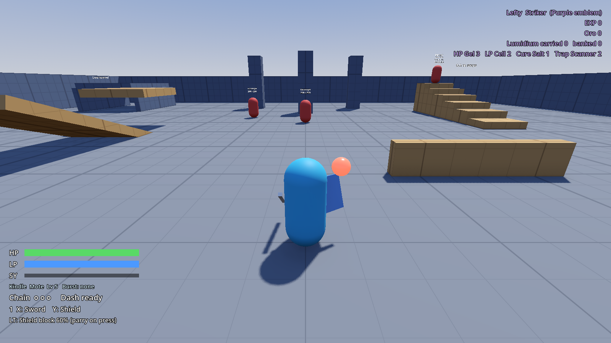

- **Starter kit:** every new character carries a Sword, a Pistol and a Wand, plus 2 Trap Scanners; only loadout 1 is filled (X Pistol, Y Sword).
- **Lock-on:** when the locked target dies, the lock moves to the next closest one.
- **Character creation:** name (type it, or "New name" on a gamepad), race, gender, job and starter SyncAIDa, with a preview of the race and job rules and the emblem the choices make. Goluman can't pick Invoker. Creating saves the slot and drops you into Nomad-2.
- **Nomad-2** (`scenes/hub.tscn`, built by `tools/build_hub.gd`): the lobby. Its counters (guild, bank, shops, armorer) are placeholders. Its **teleporter asks where to go**: the gym or the test arena (B or "Stay here" cancels; step off and back on to ask again).
- The gym has a pad back to Nomad-2, and the arena's exit now returns there too.
- **Saving:** every teleport, closing the menu, quitting to the title (Options tab) and closing the window save the character's slot.

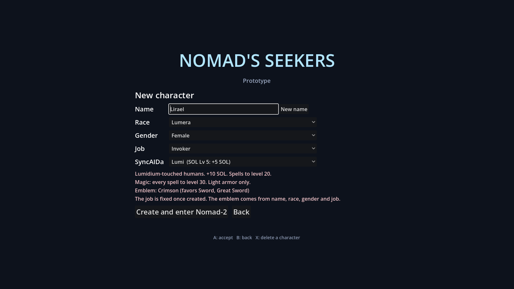
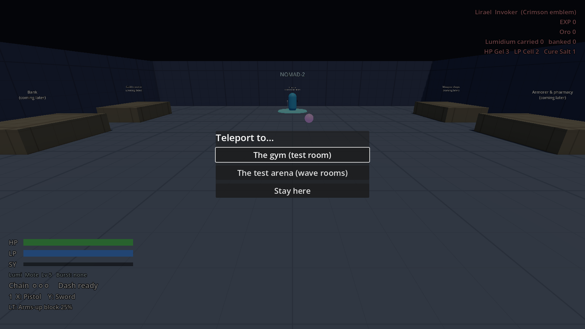

## Part 9: the pack, the satchel and the menu
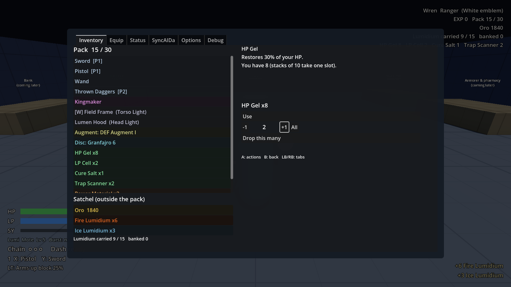

PSO's item pack with PSU's palettes (Grayson, 2026-11-09).

- **The pack holds 30 slots** of items and gear, PSO's size. Everything counts, including weapons on your palettes and the armor you wear (augments slotted into armor are part of it and don't). **Stacks hold 10 and take one slot**: HP Gel, LP Cell, Cure Salt, Trap Scanner and every material.
- **The satchel holds Oro (up to 999,999) and carried Lumidium**, outside the pack, so a pile of Lumidium never stops you picking up a rare. The satchel carries **15 Lumidium at most, all colors together**. Carried Lumidium is still lost if you fall, until a teleporter banks it.
- **Picking up takes only what fits.** With 7 HP Gels, a stack of 4 gives you 3 and leaves 1 on the ground. With the pack full, items stay where they are and the prompt says why ("pack full", "10 max", "satchel full"). Oro and Lumidium are still picked up by walking over them.
- **Dropping (trading, making room):** anything in the pack can be dropped from the Inventory tab, and so can Oro and Lumidium, **in part**: pick the amount and it lands as **one stack** in front of you (4 Lumidium is one pickup). What you drop always waits for A, Oro and Lumidium included, so walking over it doesn't take it back. As in PSO, equipped gear can't be dropped: take it off the palette (or take the armor off) first.
- **Palettes are filled from the pack**, like PSU. The palette picker lists only the weapons you carry (no more free copies of every base weapon), leaving out the one already in the other hand. A new character's palette 1 holds the pack's own Pistol and Sword. The Debug tab can add any weapon, rares included, to the pack.
- **Older saves:** weapons on a palette that weren't in the inventory are added to the pack when the save loads. A save already over 30 slots keeps everything but can't pick up more until it's under.
- **Cards and Thrown Daggers pick their targets from a 40° cone** (20° either side of the aim; it was 100°, and they fired too wide). The Burstbow keeps the PSO shotgun's 100°. **The Grenade's three-in-a-row finisher fans its three grenades over 50°** (was 30°), and all three land as far out as the target.

**The menu (Start / Tab)** now has six tabs: **Inventory, Equip, Status, SyncAIDa, Options, Debug** (LB / RB). Equip has three sections, **Palette, Spells, Armor** (LT / RT, or the buttons along the top).

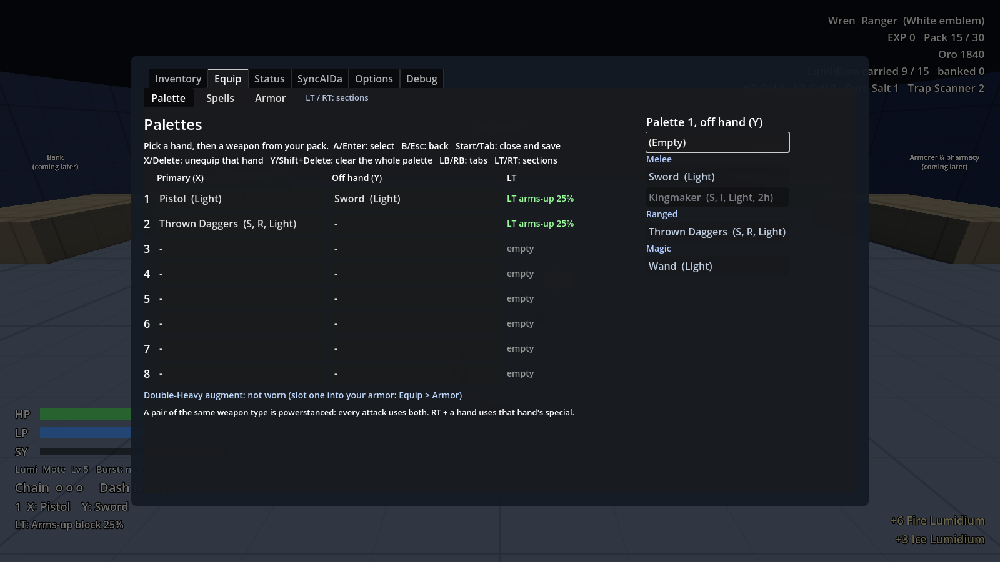
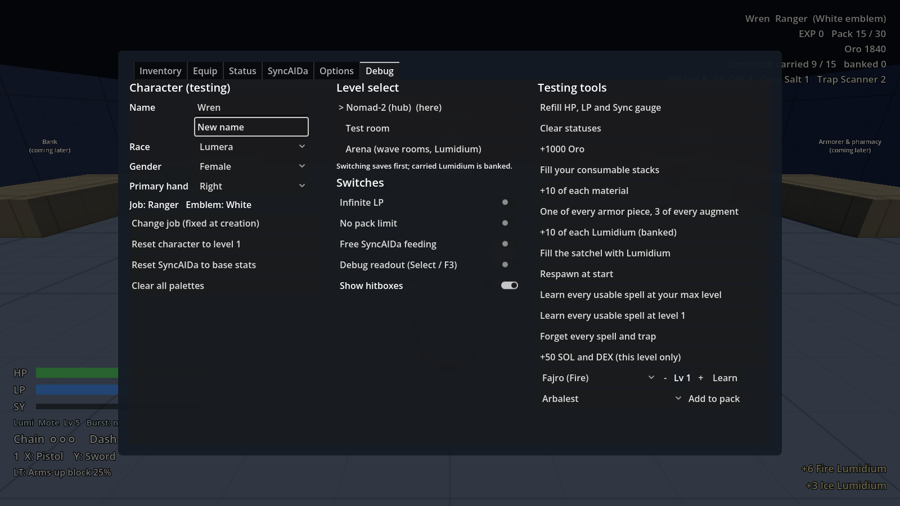

## Part 10: shops, the bank and the Guild
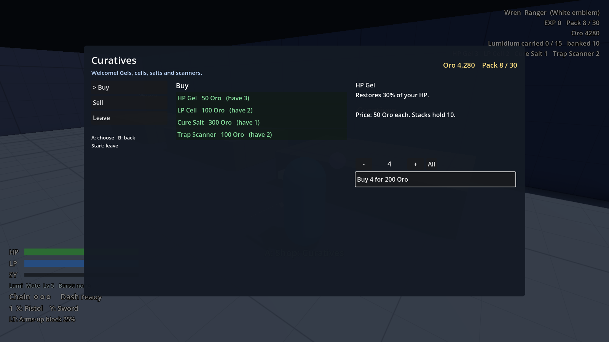

Nomad-2's counters work (Grayson, 2026-11-09). Walk up to a counter and press **A**. Each counter pauses the game and works like PSO's: the clerk's commands on the left, the list in the middle, and the details and offer on the right. A picks (command → item → confirm), B steps back, Start leaves. Stacks get an amount (- / + / All).

- **Shops** (east wall): **Weapons**, **Armor** (pieces and augments) and **Curatives**. 1 Oro = 1 Meseta.
  - **Curatives use PSO's tool shop prices** for the matching item: HP Gel 50 (Monomate), LP Cell 100 (Monofluid), Cure Salt 300 (Sol Atomizer, cures everything), Trap Scanner 100 (Trap Vision).
  - **Weapons and armor are priced on a PSO-like scale**, from the item's own numbers. PSO's exact shop formula isn't used. A weapon costs 200 + 25 × base damage (Pistol 500, Sword 700), ×1.3 if two-handed, with more for a special tag (+50% per tier) or a monster bonus. Torso armor costs 300 × tier², Heavy +20%, Head / Legs 40%, plus per slot and per bonus point. Augments cost 1,000 / 3,000 / 8,000 by grade.
  - **Stock changes every time you arrive in Nomad-2**, as PSO's arms shop did each time you entered Pioneer 2. Every listing can be bought again and again. The Weapons shop has 10 common weapons, some with low-tier tags or monster bonuses. The Armor shop has 8 tier 1-2 pieces and 4 grade I augments. Never rares.
  - **Any shop buys anything from your pack for 1/8 of its price** (my pick). Discs sell for 20 Oro per level and materials for 100 each. Palette weapons and worn armor have to come off first.
- **Bank** (PSO's Check Room, west wall): **200 item slots and up to 999,999,999 Oro** per character, the numbers on the Ephinea PSO wiki. Deposit and withdraw items, and Oro in both directions. A bank stack holds up to 99 of one item (my pick; the pack's stacks hold 10). Banked Lumidium is shown here too.
- **Guild** (west wall, PSO's Hunter's Guild): pick a quest and accept it. The hub teleporter then lists **"Quest: …"** first. Do it, come back and **Report** for the reward. You can take one quest at a time, and **Abandon quest** drops it. The quest and its progress stay in your save until you report or abandon it. There are three quests for now, all in the test arena:
  - **Arena Trial:** clear every room in one trip. 600 Oro.
  - **Hound Cull:** defeat 6 Grub Hounds. 300 Oro.
  - **Crystal Survey:** bank 10 Lumidium at teleporters. 400 Oro.
  - A banner says "Quest complete: report to the Guild" when it's done.
- The pause menu doesn't open over a counter or the teleporter's list.

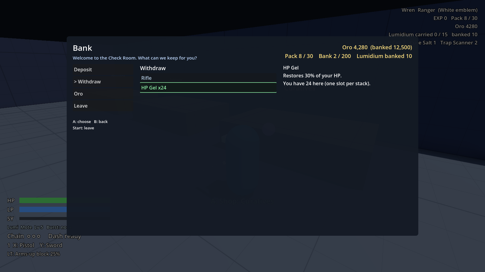
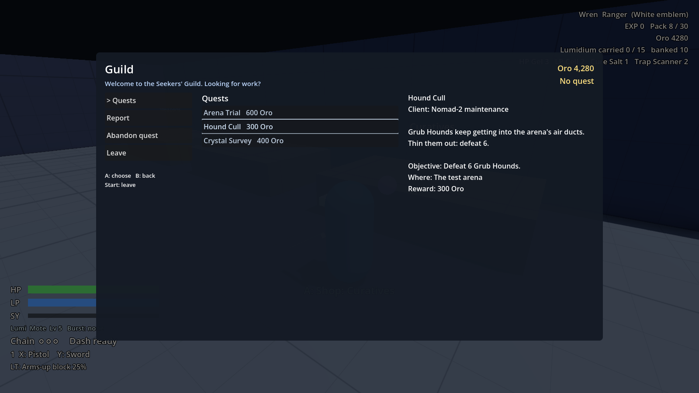

## Part 11: levels
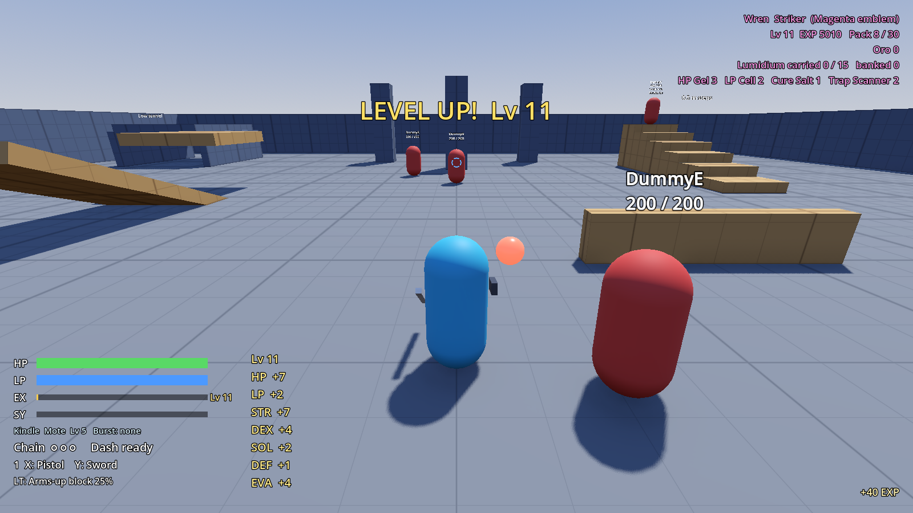

Characters level up (Grayson, 2026-11-09).

- **PSO's EXP curve, levels 1-200** (83,227,800 EXP to 200). The totals are PSO's own (Ephinea PSO wiki) at every level up to 50, at every 10th level after that, and at levels 141, 161-164 and 199. Levels between those are filled in so each level costs a little more than the last and every anchor is hit exactly.
- **Seven growth tables: one per race, one per job.** A job table holds what the job gains from level 1 to 200. A race table scales each stat. A new race or job later is one more table, with no combinations to write. `Leveling` (scripts/items/leveling.gd).
  - **Job tables** are PSO's human classes (level 200 minus level 1): **Striker = HUmar**, **Ranger = RAmar and RAmarl averaged**, **Invoker = FOmar and FOmarl averaged**.
  - **Race tables** are PSO's other races against the humans, averaged over jobs: **Lumera = Newman** (more SOL, LP, DEF and RES; less HP and STR), **Coresian = CAST** (HUcast / RAcast: more HP, STR and DEF), **Goluman = CASEAL** (HUcaseal / RAcaseal: more HP and DEX, good EVA).
  - So a **Coresian Striker grows like a HUcast** and a **Lumera Invoker like a Newman Force**.
  - Things PSO doesn't have, so I picked them: PSO has one ATP stat, so the job's main stat gets it all and the other gets 65% (Invokers get 600 in both). RES is 75% of the average of DFP and MST. CASTs have no MST or TP, so Coresians get half SOL and half LP, and Goluman a quarter SOL and half LP.
  - **LCK never grows**, like PSO.
  - Stats grow in PSO's shapes: attack stats, SOL, LP, EVA and ATA early; HP later; DEF and RES latest.
- **Level-up:** the screen flashes, a **LEVEL UP! Lv N** banner shows, and a PSO-style list of what each stat gained appears beside the bars. **HP and LP refill.**
- **EXP bar** under the LP bar, with the level beside it. The Status tab shows the level, EXP and EXP to the next level. The character select shows the level.
- **Armor has level requirements:** tier 1 level 1, tier 2 level 25, tier 3 level 60, tier 4 level 100. The rares have their own: Pathfinder Treads 20, Huntress Treads 30, Veil of the Nomad 40, Warden's Crown 50, Ironclad Shell 70.
- **Weapons have stat requirements**, like PSO: STR for melee, DEX for ranged, SOL for magic. The amount is 6 per point of base damage above 20, in steps of 5. Pistol, Sword and the casting items need nothing; Great Sword needs STR 85 and Arbalest DEX 240. Rares need 80 more. The palette picker and the Inventory won't equip a weapon your stats can't use, and they say what's missing. **Shops still sell gear you can't equip** (job-locked, stats or level too low), for another character, a friend or later: it's marked "(can't equip yet)" in orange. Grey only means you can't afford it or your pack is full.
- **Spells and traps** were already limited by stats (SOL, or DEX for traps) and still are.
- **Shop tiers rise with your level:**
  - **Armor shop:** tiers within 5 levels of your level, the top two only.
  - **Augments:** grade II from level 40, grade III from level 100.
  - **Weapons shop:** higher special-tag tiers every 50 levels, and bigger monster bonuses.
  - Stock is rolled the first time you open a shop on each visit.
- **Debug tab:** Level +1 / +10 / +50 / Max, done with EXP so the level-up shows. Reset character now goes back to level 1 and takes off armor above it.

## Part 11 (continued): room hazards, buttons and a menu that doesn't pause
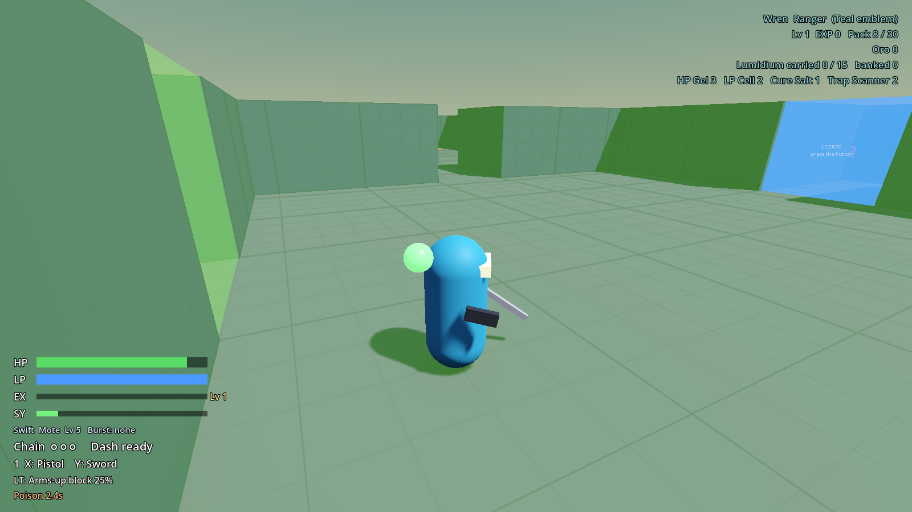
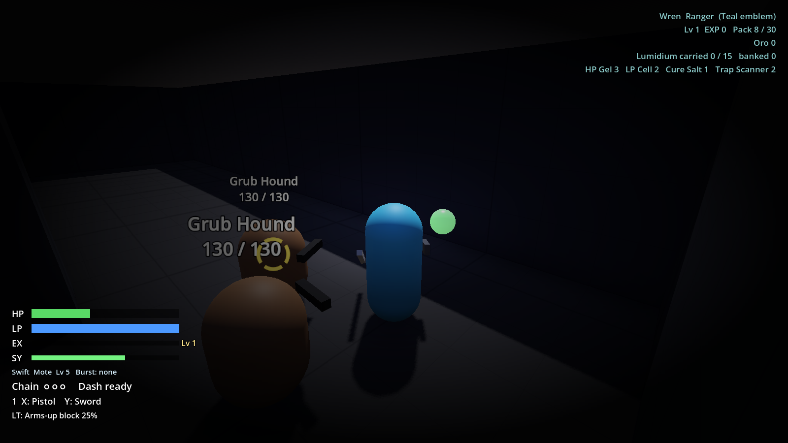

PSO-style hazards and buttons (Grayson, 2026-11-09).

- **Room hazards** (`RoomHazard`) belong to rooms but can **span several boxes**. The poison mist covers the poison room and its corridor. A button turns them off or on.
  - **Poison mist:** drains 2% of max HP a second from anyone inside, Goluman included. It isn't the Poisoned status, and like PSO's poison it never takes you below 1 HP.
  - **Darkness:** while you're inside you can't see more than **4 m** from your Seeker: everything farther is drawn black (a depth shader, one per Seeker, so a partner outside the room still sees normally). Lock-on still reaches into the dark and the target rings show through it, but **enemies past your sight are 25 points harder to hit** (spells still never miss). From outside, the room looks normal.
- **Buttons** (`RoomButton`) come in groups (`SwitchGroup`). When every button in a group is down, the group acts on its targets: open, close or toggle a door (`SwitchDoor`); turn a hazard off, on or toggle it; start a room's waves; turn traps off.
  - **Press buttons:** a pedestal you press with A, once.
  - **Floor plates:** you stand on them. Alone, every plate but the last stays down once stepped on (PSO), and the last needs you on it. **In co-op, plates minus Seekers stay down**: four plates with two Seekers means two latch and the last two need a Seeker on each.
- **Arena east wing**, through Room B's new east doorway:
  - **Poison room:** the mist fills the room and its corridor. The button in the corner opens the east door and clears the mist.
  - **Switch hall:** a branch north of the poison room. **Four floor plates** open the door to a Lumidium alcove.
  - **Dark room:** two waves in the dark. The **button in the far corner** turns the darkness off, but the north door only opens once every enemy is dead. Past it, the end room's teleporter goes back to Nomad-2. Every wave room must be cleared, as with the old exit.
- **The menu no longer pauses the game**, like PSO. While it's open your Seeker stands still and takes no game input (no moving, attacking, items, lock-on or camera), but enemies, statuses and hazards carry on. The shop, bank and Guild counters and the teleporter's list still pause for now.


## Part 12: local co-op
Couch co-op for up to four, split-screen.

- **Joining:** press **Start on another controller**. A new pane opens with your saved characters. Pick one that isn't already playing (create characters from the title screen first). Alone, the leader plays with any controller; the first one used is theirs, and the keyboard and mouse always belong to the leader.
- **Split screen:** two Seekers split the screen left and right, three or four use quarters. Each pane has its own camera, HUD, menu, counters and teleporter list, and only hears its own controller. Menus are scaled to fit a half-height pane. Each Seeker's target rings only show in their own pane.
- **Your own character:** each guest plays one of the saved characters with their own pack, palettes, level and SyncAIDa, saved like the leader's.
- **Together:** everyone on the same map gets each kill's full EXP, enemies chase the nearest Seeker, floor plates count everyone (Part 11's rule), and a Goluman's trap vision shows traps to the whole party.
- **Falling:** a Seeker who falls while a partner is still standing stays down. A partner's **Revive** brings them back, or they press **A** to go back to the start (carried Lumidium is lost). When everyone is down, everyone goes back.
- **Leaving:** a guest picks "Save and leave the party" in the Options tab. When the leader quits to the title, everyone does.
- Counters and the teleporter's list no longer pause the game, like the menu.

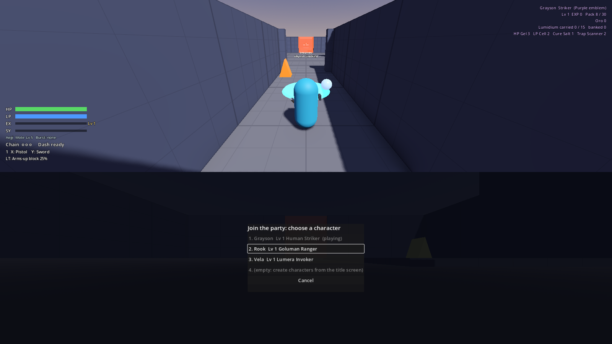
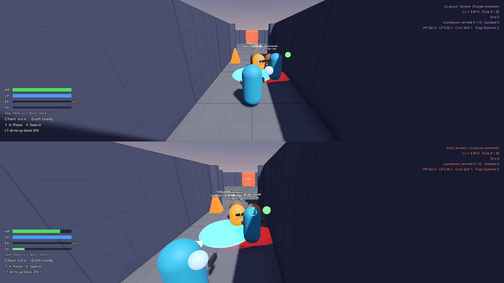
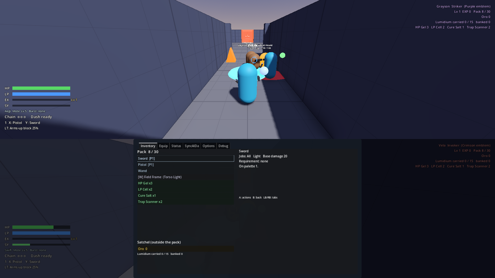


## Part 12 (continued): the d-pad palette and Goluman traps
- **D-pad palette:** the d-pad is four slots (left, up, right, down), and **holding RT shifts to four more**, ready for more items. Fill them in **Equip > D-pad**: A on a slot, A on an item (X clears; an item moves if it was already on another slot). It starts with HP Gel, LP Cell, Cure Salt and Trap Scanner where they used to be. The HUD shows the current page (the RT page while RT is held).
- **Goluman: Traps replaces Spells.** The same palette, plus their learned traps. A trap on the d-pad is set at their feet for its LP (up to 4 at once).
- **Spells section on a controller:** with no casting item equipped, focus goes to your learned spells (or the section buttons) instead of nowhere. Up from the top of any column reaches the section buttons, and down from them goes back in.

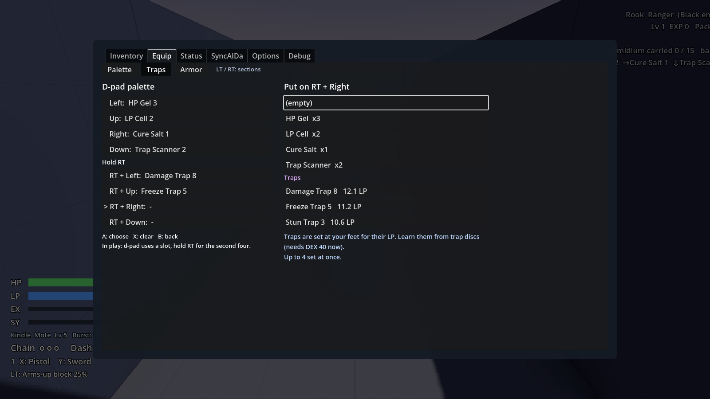
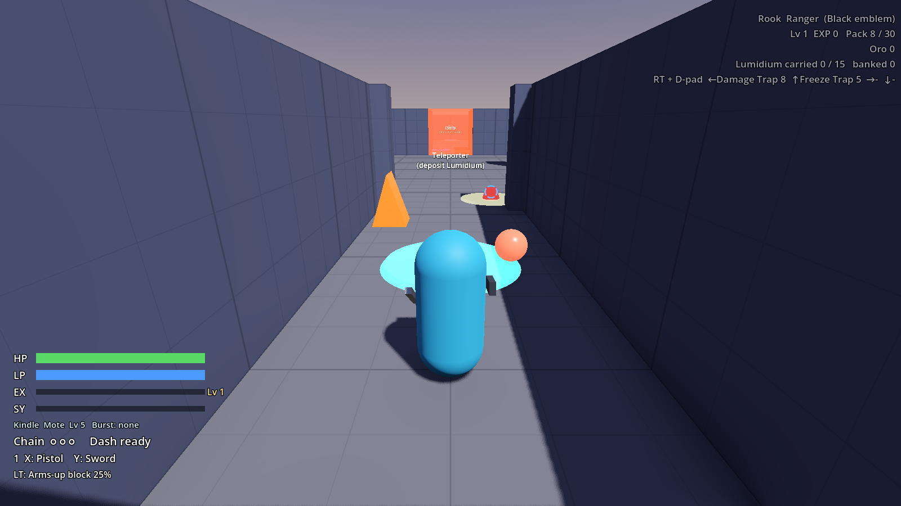


## Part 12 (continued): co-op playtest fixes
- **Split screen is left / right** for two Seekers (widescreen first), with 10° more vertical FOV in a half-width pane. Menus scale to fit.
- **Each Seeker travels on their own.** One can go to Nomad-2 to sell while the other explores. A map nobody else is on runs in its own world beside yours (`CoopDirector`), and each pane looks into its Seeker's map. Maps nobody is on are closed.
- **EXP:** every party member on the same map gets the full EXP of every kill, whoever made it and even while down. Members on other maps get none.
- **Enemy stats don't change in co-op**, like PSO.
- **Discs go into the pack** when picked up, to be read from the Inventory tab. Nothing is learned or sold on the spot.
- **Lock-on is gentler:** it, and the retarget after a kill, only pick targets in front of the camera and within 75% of the way from the screen centre to the edge, so the lock never swings to something behind you. Switching targets is unchanged.
- **Boomerangs** skip targets that die before they arrive (this used to throw an error), and fly back to the thrower when done.

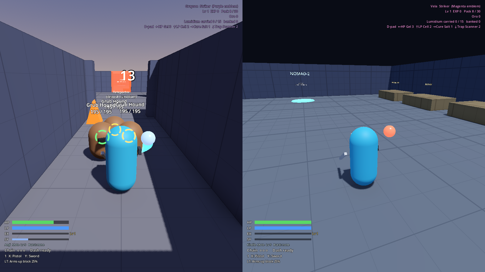


## Part 12 (continued): second playtest round
- **Traps take 3 seconds to arm**, like PSO, blinking faster as they get close. **Any Seeker can hit a set trap to spring it early**, armed or not: lock on to it (enemies are preferred) and shoot, swing or blast it. A Ranger can pop a Goluman's bomb as enemies close in. Traps don't set each other off.
- **The palette in use is remembered** across maps (it's in the save).
- **Nomad-2 is peaceful:** no attacks, spells, traps or Sync Bursts there (`peaceful` on the level).
- **Bladestaff's last step hits all around you**, matching its spin.
- **Lumidium depots:** teleporters no longer bank Lumidium. Depots do, and only when you press A at one. There's one at the start and at each exit of the arena, one in the gym, and one by Nomad-2's bank. Carried Lumidium now stays in your satchel across maps (it's in the save) and is still lost if you fall.
- **The bank's Oro counter is now Resources:** Oro, plus deposit and withdraw for each Lumidium color, so you can take Lumidium out to trade. The bank holds up to 99,999 Lumidium. The satchel's size is saved per character (15 for now), so quests can raise it later.

## Part 13a: levels made from data (for the level editor)
The runtime the separate level editor needs (Grayson, 2026-11-12). The format itself is documented in **[docs/level_format.md](docs/level_format.md)**; this is what the game does with it.

**Format 2** (Grayson, 2026-11-13): levels are built only from placed pieces, each a **floor** (walked on), an **obstacle** (blocks the navmesh) or **intangible** (no collision), with a **concave** or **convex** hitbox generated from the model (`LevelNav.hitbox`, shared with the editor so the game builds exactly what the editor previews). Rooms and corridors are **areas of the navmesh**, split by invisible **room boundaries**; the editor saves each area's navmesh polygons and the game turns them into the room's trigger (`WaveRoom.trigger_area`) and the Trap Scanner's "room you're in" (`LevelRoom`). The navmesh is baked at load by `LevelNav.bake`, sized for a Seeker (radius 0.4 m, 0.2 m cells) and the same bake the editor shows. The size follows the room count. Version 1 levels aren't read any more; the demo level was rebuilt from boxes and boundaries.

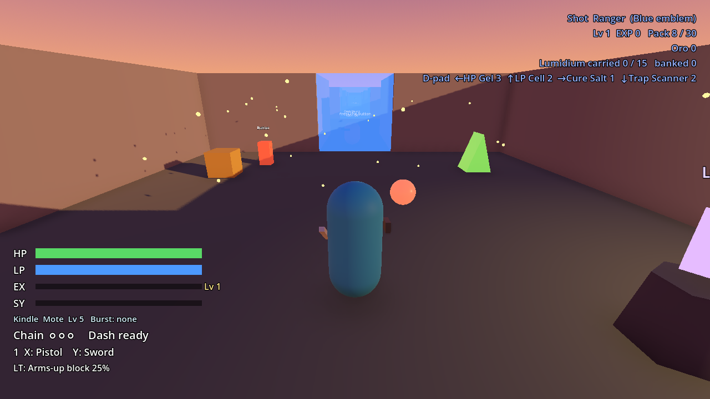

- **Levels are folders of JSON** (`level.json`, `map.json`, `interaction.json`, `combat.json`) plus glTF models, never scenes or scripts, so shared levels (the Steam Workshop, some day) can't run code. `addons/seeker_data/level_data.gd` (`LevelData`) reads, writes and checks them and doesn't depend on the game, so the editor can use the same file.
- **Sizes**: Arena (1 room, no corridors), Small 5-9, Medium 10-14, Large 15-19, Huge 20-25 rooms; corridors don't count.
- **Area folders and session picks** (`Maps`): `res://levels/<area>/` holds an area's levels (Forest 1, Forest 2, Forest Boss each get one). A destination of `area:forest_1` becomes this session's pick from that folder, kept until you quit to the title; co-op shares the picks. Teleporters, quests, co-op and the Debug tab now work with **map ids** (a scene path or a level folder), so data levels travel, host in co-op and count for quests like any scene.
- **`DataLevel`** (`scenes/data_level.tscn`) builds a level at load:
  - Layer 1: lighting presets with sliders clamped to safe ranges, the start point, rooms and corridors (`LevelRoom`: room areas the Trap Scanner uses), pieces (built-in boxes, cylinders, ramps, stairs with a step count and curved walls with a bend, painted with level materials (`LevelMaterials`, world-mapped images), or imported glTF loaded at runtime with box or mesh collision; `LevelAssets`), invisible walls (everyone, or **Seekers only** on the new physics layer 5), decorations (fireflies, lights, searchlights, models) with animation presets (`DecorAnimator`: sway, bob, spin, pulse, sweep). The navmesh is baked from anything solid.
  - Layer 2: doors (with "open when room X is cleared" and "shut while room X fights"), teleporters (now able to sleep until woken), Lumidium depots and nodes, **breakable supply boxes** (`SupplyBox`), traps, buttons and button groups, hazards, **trigger zones** (`TriggerZone`, optionally waiting for the whole party), **moving platforms** (`MovingPlatform`: loop, ping-pong or step), **bridges** (`Bridge`: slide out; their navigation link only works while they're out, so enemies chase across only then) and **dialogue** (`DialogueBox`, lines and choices).
  - **Wiring** (`LevelEvents`): when an event happens (a zone entered, a button group pressed, combat started / a wave cleared / combat ended, an enemy defeated, a boss below N% HP, a dialogue ended with a choice, a box or crystal broken, a timer, a flag), if conditions hold (flags, party size, difficulty, an active quest), do actions (any object's switch action, start a room's fight, dialogue, flags, timers, give items, complete a quest objective, a banner, wait).
  - Layer 3: wave rooms whose enemies are placed one by one with **spawn delays**, rooms that wait for the wiring instead of starting on entry, and **corridor enemies** outside waves.
- **Enemy leashes** (`Enemy.configure`): wander within a radius of the spawn point, and limited chase (give up past a radius from the spawn point, walk home without healing, pullable again once back); a chase radius below the wander radius is invalid. Aggro range short / normal / long. Stats and attacks never change.
- **Quests from data**: `quests/*.json` add Guild quests; a new `event` objective is completed by a level's wiring. Quests can point at `area:` destinations.
- **Playtest**: `godot --path . -- --level=res://levels/test_1/demo` goes straight into a level with your last character (the editor's Playtest button will use this).
- **The demo level** (`levels/test_1/demo`, written by `tools/build_demo_level.gd`): a Small level using every layer, reachable from Nomad-2's teleporter ("Demo level (made from data)") and the Debug tab's level list, with the quest "Demo Run" at the Guild.

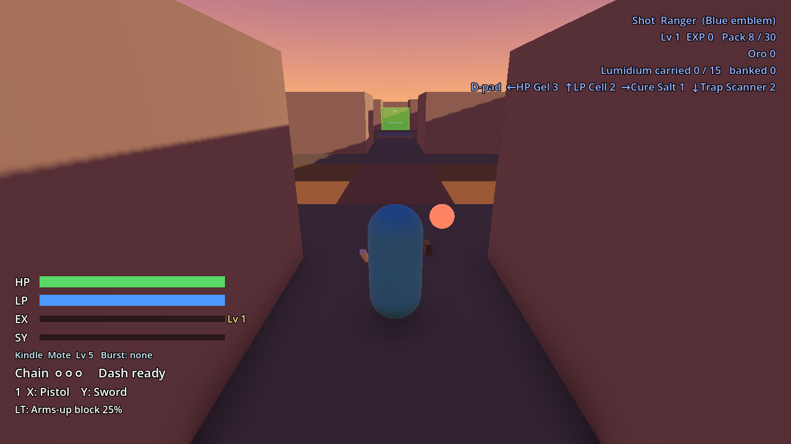

## Travel
Nomad-2's teleporter goes to the gym or the arena. The gym has pads to the arena and back to Nomad-2. The arena's exit pad at the far end of Room B stays dark until every room is cleared, then takes you back to Nomad-2. **Press A on a pad** to use it (it saves first); standing on it does nothing.

**Maps persist for the session (2026-11-12, like PSO).** A session starts when you load into Nomad-2 and ends when you quit to the title. Every map you visit stays exactly as you left it: killed enemies stay dead, items stay where they fell, rooms stay cleared, an enemy mid-chase is still there. A map nobody is on is **parked**: its scripts, physics and navigation stop and it isn't drawn, then it wakes as it was when someone arrives (`CoopDirector`). Shops restock each time Nomad-2 wakes. From the first trip you play in one full-window view (the co-op split screen with one pane).

**Teleportal (PSO's telepipe):** one per Seeker. Casting it opens a pad where you stand that goes to Nomad-2, and a matching pad on Nomad-2 (in a row in front of the spawn, one spot per controller) that goes back to that spot. Anyone can use either end. The field end leaves both open; the Nomad-2 end takes you back to the spot and then **both ends close**. Going back to the area some other way (the normal teleporter) leaves it open. Casting again moves it. Neither end times out (`Teleportals`).

**The game never pauses.** Menus, counters, the teleporter list and dialogue all leave the world running: you can't move or attack while one is open, but enemies can still hit you, so swapping gear or using items mid-fight is a risk.

**Arena doors (PSO-style):** the way into a room stays open, and the way on is locked ("LOCKED") until the room is cleared. Clearing the last room wakes the exit pad.

## Menu (Start / Tab)
Fully usable with a gamepad: d-pad or left stick moves, **A** accepts, **B** goes back (closes a list or the actions, then the menu), **LB / RB** switch tabs, **LT / RT** switch the Equip sections, Start closes.

| Tab | What's there |
|---|---|
| Inventory | The pack (30 slots: `[P1,3]` marks palette weapons, `[W]` worn armor) and the satchel (Oro, carried Lumidium). The focused item is described on the right. **A** lists what you can do with it: equip a weapon to the current palette (primary or off hand), take it off every palette, wear or take off armor, slot an augment into a free slot, use a consumable or material, read a disc, drop (with an amount for stacks, Oro and Lumidium) |
| Equip: Palette | 8 PSU-style palettes (X / Delete unequips the highlighted hand, Y / Shift+Delete clears that palette), the weapon picker (your pack's weapons by group; job-locked weapons are grey and A on one says which job needs it), Double-Heavy status |
| Equip: Spells | Casting items on your palettes → their slots → your learned spells (A picks, X clears a slot, B goes back). Also lists stored discs to read |
| Equip: Armor | Head / Torso / Legs and their augment slots → armor or augments in your pack (A wears or slots, X takes off or empties, B goes back), totals and resists |
| Status | Name, race, gender, job, hand, emblem, EXP, HP / LP, every stat with everything applied, materials used, spell level caps, drop pool |
| SyncAIDa | Starter choice, pairing, feeding (consumables from the pack, Lumidium from the bank), active Sync Burst |
| Options | Save and quit to the title screen, the control reference. Settings will go here |
| Debug | Everything for testing, in one tab that can be removed with one line (`LoadoutMenu._build`): name / race / gender / hand edits and the job switch, level select, refills, Oro, filling consumable stacks, materials, every armor piece and augment, Lumidium (bank or satchel), add any weapon to the pack, learn tools, Infinite LP, **No pack limit**, free feeding, debug readout, hitboxes, resets, clear all palettes |

Show hitboxes (Debug tab, on by default) also draws enemy melee hit areas on the ground: faint during the windup, bright when the strike lands, with the exact reach and arc the hit uses. The debug readout is off by default. Select / F3 or the Debug tab turns it on.

## Controls
| Action | Gamepad | Keyboard / mouse |
|---|---|---|
| Move | Left stick | WASD |
| Camera | Right stick | Mouse / arrows |
| Jump | A | Space |
| Dash / dodge (5 s cooldown) | B | Shift |
| Lock on / recenter | R3 | Q / middle mouse |
| Switch target | Flick right stick | Sweep mouse |
| Hand attacks (tap / hold) | X / Y | Left / right click |
| Cast (tap) / Hard cast (hold) | X / Y with a casting item | Left / right click |
| Spell slots 2 / 4 (hold while casting) / special | RT | E |
| D-pad palette (items; traps for Goluman) | D-pad left / up / right / down, hold RT for 4 more | 1 / 2 / 3 / 4, hold E |
| Activate a teleporter / pick up an item (when the prompt shows; otherwise jump) | A | Space |
| Sync Burst | L3 | R |
| Cycle palettes | LB / RB | Z / C |
| Block / powerstance | LT | F |
| Menu | Start | Tab |
| Toggle debug panel | Select | F3 |
| Join the party (co-op) | Start on another controller | |

Click to capture the mouse, Esc to release it.

## Tuning
Every feel value is an exported variable or a `.tres` field. Edit them in the Inspector, even while the game is running (use the Remote tree).

- **Player**: `move_speed`, `acceleration`, `jump_height`, `time_to_peak`, `dash_distance`, `dash_duration`.
- **CameraRig**: `follow_mode`, `leash_radius`, `follow_speed`, `pitch_return_delay`, `pitch_return_speed`, `shoulder_offset`, `default_pitch_deg`.
- **Player/Combat**: `hold_threshold` (tap vs hold), `swap_hand_buttons` (X on the off hand), soft-aim range and angle, `show_hitboxes`.
- **Each attack** in a weapon `.tres`: `move_speed_scale`, `face_movement`, `sustained_tick`, `duration`, `active_start`/`active_end` (hit timing), `window_open`/`window_close` (combo timing), `damage_mult`, `lp_cost`, lunge, hitbox size, projectile settings.

## Physics layers
1 = world, 2 = player, 3 = enemy, 5 = seeker_walls (Part 13a: invisible walls only Seekers collide with). The camera, lock-on line-of-sight checks and navmesh bake only use layer 1.

## Known limits (deliberate for now)
- No animation: capsules, with weapons swung by simple tweens. Melee hitboxes show as red boxes (`show_hitboxes`).
- Normal attacks fire when the button is released, so tap and hold can share one button.
- Only the arena has Lumidium nodes, and every Guild quest happens there until real levels exist. Shop stock has no character-level tiers yet (armor stops at tier 2).
- Weapon grinding, armor and augments aren't in yet. Untagged weapons have no RT special.
- Enemies don't scale with level or area yet: past the first few levels, the arena gets easy.
- Party bursts (several Seekers firing together) aren't in yet. SyncAIDa have no feeding cooldown and no personalities yet.
- Co-op: partners' HP isn't shown in your pane yet, and menus get small text in a half-height pane.
- The runtime navmesh bake prints a warning because the CSG blockout has no separate collision shapes. It's harmless at this size and goes away with real level geometry.
- No step-up for small ledges yet.

## Automated tests
Run from the project folder. Each prints `ok` or `FAIL` per check and exits with code 1 if anything fails.

```
godot --headless --path . --script res://tests/movement_test.gd
godot --headless --path . --script res://tests/level_test.gd
godot --headless --path . --script res://tests/combat_test.gd
godot --headless --path . --script res://tests/loadout_test.gd
godot --headless --path . --script res://tests/targeting_test.gd
godot --headless --path . --script res://tests/enemy_test.gd
godot --headless --path . --script res://tests/loot_test.gd
godot --headless --path . --script res://tests/syncaida_test.gd
godot --headless --path . --script res://tests/menu_test.gd
godot --headless --path . --script res://tests/magic_test.gd
godot --headless --path . --script res://tests/materials_test.gd
godot --headless --path . --script res://tests/armor_test.gd
godot --headless --path . --script res://tests/flow_test.gd
godot --headless --path . --script res://tests/inventory_test.gd
godot --headless --path . --script res://tests/services_test.gd
godot --headless --path . --script res://tests/leveling_test.gd
godot --headless --path . --script res://tests/hazards_test.gd
godot --headless --path . --script res://tests/coop_test.gd
```

- `movement_test.gd`: walking, stopping, jump height, short hops, dash distance, the 5 s dash cooldown, lock-on, orbiting, recentering, camera height return.
- `combat_test.gd`: tap and hold, 3-step rhythm combos, PSO pistol cadence, rooted vs mobile attacks, Dervish Blades combo and spin, step damage bonuses, too-early and too-late presses, mixed-weapon steps, LP, projectiles, spells and Shift, elemental weakness, dash cancel, death and respawn, navmesh bake, chase and patrol pathing.

- `loadout_test.gd`: one-Heavy and two-handed rules, the augment, cycling past empty and invalid loadouts, LT mode per loadout, shield / arms-up / two-handed block percentages, parry and stagger, no block from behind, Deflect, dash dodge, Heavy Shield shove, blocking a real Shooter bolt, powerstance twin hits and twin combos, twin pistols, the powerstance option, and the menu opening and pausing.

- `targeting_test.gd`: default buttons (X = primary hand); Sword marks one of two side-by-side enemies and Great Sword marks both, and real swings hit exactly what was marked; blue / yellow / green per hand, and using one hand doesn't hide the other hand's marker; the Pistol and Fire Bolt mark the first enemy in line and Frost Lance marks the whole line; lock-on shows the large ring and hides it on release, and the lock moving to the next closest target when the locked one dies.

- `enemy_test.gd` (in the arena): all six monster types, DEF / RES math, hit chance (ATA vs EVA, combo steps, Hard openers, the streak, statuses lowering EVA, spells never missing), every status (Burn ticks, Ice freezing without Slow, Slow halving speed, Shock, Confuse, Drain healing its source), a Hound pathing to you and hitting for its damage, Hard hits pushing and flinching (light hits never interrupting), a Frozen enemy standing still, a Drone keeping its distance and shooting, Ward reflecting a Drone bolt into the Drone, and a full three-wave room (doors close, waves follow each other, doors open), and PSO doors (the exit locked until the room is cleared).

- `loot_test.gd` (in the arena): the full weapon list and every emblem's favored families, job locks, the 7 rares covering all 10 emblems, drop rates and emblem weighting, tag tiers, tag names and RT specials, the +30% vs Beast bonus, status and burst lines (half-damage status specials, a burst reaching two nearby enemies, element-less lines keeping the weapon's type), the Jarring stun line, Sanguine / Lucid / Oracle's / Oblivion effects (and Oblivion never killing a boss), the Tithe special paying Oro, Shotgun pellets, a Grenade arc and its blast (and its prediction), the Boomerang lock chain, the Gigarang hitting out and back, the Thrown Daggers finisher, Machine Pistol automatic fire, the Staff's four spells, Heal and Cure, EXP and drops, pickups and an HP Gel, a Lumidium node breaking, losing carried Lumidium on death, a teleporter deposit, and a save round-trip, Oro picked up on touch while items wait for A, and teleporters needing A.

- `syncaida_test.gd` (in the arena): no SyncAIDa until a starter is chosen, the four starters at level 5 in their stat and the instant bonus, level-10 forms following stats rather than job, feeding from inventory and bank, the stat math, the Seeker stat bonus following the paired SyncAIDa, every evolution (job, strongest stat, top two, Prime), burst unlocks, the 200 cap, the gauge from damage dealt and taken, L3 firing Lumen Nova (in range only), Aegis Pulse in both directions, Mending Bloom, feeding from the menu, and a save round-trip.

- `menu_test.gd` (in the arena): drives every tab with real joypad button and trigger events: Start opens, starter pick with the d-pad and A, re-pressing the paired SyncAIDa, feeding, RB / LB tab switching with focus following (the six tabs in order), the Palette picker (only the pack's weapons, B backs out, a job-locked weapon explains itself, A equips), LT / RT switching the Equip sections, the Debug tab's New name, dropdowns and tools, Options, B closing the menu, and switching levels.

The tests always use a fresh save and never write yours.

`tools/build_starter_weapons.gd`, `tools/build_enemies.gd` and `tools/build_arena.gd` regenerate the weapons, enemies and arena with their default values (this overwrites any edits).

- `session_test.gd` (Nomad-2 and the arena, own slot folder): a session starting in Nomad-2; the first trip keeping Nomad-2 parked (no processing, physics or navigation) in a one-pane view; enemies hitting you while the menu is open (never paused); a Teleportal's two ends, the field end to Nomad-2 keeping both, the arena parked with nothing moving, Nomad-2 restocking on the visit, the Nomad-2 end returning you to the spot and closing both; the arena as you left it (dead enemy, the other enemy, the dropped item, cleared rooms); the normal teleporter leaving the Teleportal open; recasting moving it; quitting to the title closing every map and Teleportal.
- `magic_test.gd` (in the arena): the spell book (46 spells, 7 traps, grid names), PSO technique power and LP tables, SOL requirements, level caps by race and job (buff / debuff caps, Invokers 30, special spells), Goluman rules, casting from loadout slots (empty and unlearned slots), the damage formula, every damage shape reaching the enemies it should, holding a sustained spell, buffs scaled by support power, debuffs around you, auras, Heal, Cure 9 keeping buffs, Teleportal, trap placing, springing and the 4-trap limit, hazards visible only to Goluman, trap devices (untouchable while hidden, even by area spells; the Trap Scanner on D-pad down revealing only the current room; destroyed by a spell once revealed), discs (learn, store, read later, sell), disc drop rates, and the Spells tab driven by a gamepad.

- `materials_test.gd` (in the arena): the ten materials, the 275 / 175 / 150 shared limits and the separate HP / LP 125, Goluman restrictions (no Mind, 75 LP), STR / DEX / RES / ATA / max HP gains, Goluman +10 DEX and HP regen, LP regen for Goluman and Lumera only, Invokers refused as Goluman, the learn-at-level-1 and Infinite LP tools (and ATA improving hit chance), the limits refusing more, the save keeping materials used and re-applying them once, drops and pickups, using one from the Inventory tab with a gamepad, and Reset character forgetting them.

- `armor_test.gd` (in the arena): the armor book (24 tiered pieces, 5 rares, slot rules, job-locked sets), drop rolls (0-4 / 0-1 slots, DEF / EVA bonus), the starter Field Frame, who can wear what (Invokers Light only, job, race and gender locks), swapping pieces with their augments, stat augments, Fire Wards and a Beast Guard in real hits, Double-Heavy from an augment, unwearable armor coming off after a race change, drop rates (Blue emblem 2x), pickups, the save, old saves, and the Armor tab with a gamepad.

- `flow_test.gd`: the old single save moving into slot 1, the title screen with a gamepad (main menu, character select, B back, Start, focus surviving a background click and coming back after it's lost, in the title, the teleporter picker and the pause menu), creation (Goluman can't be Invokers, the preview), the new character's starter kit (Sword, Pistol, Wand; only loadout 1 filled), saved to its slot with its SyncAIDa and Field Frame, Nomad-2's teleporter (pauses, lists the gym, arena, the demo data level and stay; B cancels), travel to the gym and back and to the arena with saves on the way, quitting to the title, Continue, deleting with a double X, and full slots. It uses its own folder, so real characters are never touched.

- `inventory_test.gd` (in the arena): a new Seeker's pack (Sword, Pistol, Wand; palette 1 holding the pack's own Pistol and Sword), worn armor and palette weapons taking slots, stacks of 10 in one slot, a stack pickup taking only what fits and leaving the rest, the 30-slot limit (items refused, Oro still taken, existing stacks still filling), the 15-Lumidium satchel, and the Inventory tab with a gamepad: equip to a palette, equipped and worn gear refusing to drop, use, wear, a material, dropping part of a stack, Oro and Lumidium as one pickup each, dropped Oro and Lumidium waiting for A, and the palette picker listing only the pack.

- `services_test.gd` (in Nomad-2, then the arena): the five clerks and their prompts, PSO's curative prices, weapon prices, stock (sizes, no rares, armor tiers, rerolled per visit), buying stacks with an amount, gear, armor and augments with a gamepad, not enough Oro, a full pack, selling back at 1/8 (palette weapons refused, stacks by amount), Start leaving without the pause menu, B backing out, the bank (200 slots, items, stacks, Oro both ways, kept in the save), and the Guild (accept, one at a time, reporting early, the teleporter listing the quest first, defeats, room clears and banked Lumidium completing quests, the reward, abandoning).

- `leveling_test.gd` (in the arena): PSO's EXP curve at its anchor levels and rising every level, level lookups, the seven tables (and nothing gained at level 1), Human Striker = HUmar's growth, Coresian Striker above it like HUcast, Lumera Invoker above a Human Invoker like a Newman Force, Rangers' ATA, LCK never growing, a level-up (stats, HP / LP refill, banner, gains list, flash, the EXP bar under LP), a multi-level jump, armor level requirements (tiers and rares), weapon stat requirements (Pistol, Great Sword, Arbalest, rares; the palette refusing), shop tiers by level, the Debug tab's level tools, Reset character, and the save.

- `status_test.gd` (in the arena): every duration (Shock and Poison until cured), struggling out of Freeze with buttons and the stick (Burn with the stick only), Poison ending at 1 HP, difficulty scaling, Goluman and enemy Shock, status-line specials building their status, Ice (weapons and spells) freezing without Slow, Slow coming from the Slow trap, Light confusing, a confused enemy attacking another enemy, and a confused Seeker hitting and healing friend and foe, locking onto partners, losing target rings, seeing ghosts with the real models hidden from their camera, and the haze.
- `hazards_test.gd` (in the arena): poison mist (draining HP, never below 1, not the Poisoned status, spanning the corridor, draining Goluman too), Goluman statuses (immune to Poison and Stun, stopped by Shock; others still move while shocked), Stun ending on Cure or a hit but not on damage over time, its button opening the door and clearing it, the four floor plates (three latch alone, the fourth needs you; with two Seekers two latch and the last two need one each), darkness (the HUD darkens, the corner button clears it, the exit still waits for every enemy), buttons starting waves and turning traps off, and the menu not pausing (no movement while it's open, poison still ticking).

- `level_test.gd` (Part 13a): the level format (sizes, the publish check, the leash rule, lighting limits, save and load), area folders and session picks, quests from JSON, a glTF written at runtime loading back with collision (and files outside the level folder refused), then the demo data level played: lighting, room areas, the navmesh, a dialogue zone (input locked, dialogue_ended), a button-opened gate, the corridor hound wandering, giving up its chase past its leash and walking home, the arena's doors (shut during the fight, open when cleared) and spawn delays, the Seeker-only wall, floor plates extending the bridge (no path over the pit before, a path across after), the moving platform, the mist button, the whole-party zone starting the boss call whose end starts the fight, the boss's 50% HP rule, and the dormant exit waking and completing the quest.
